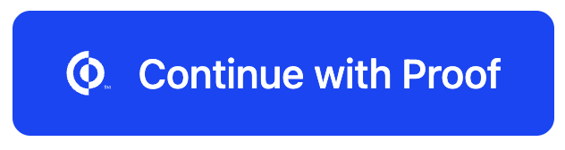
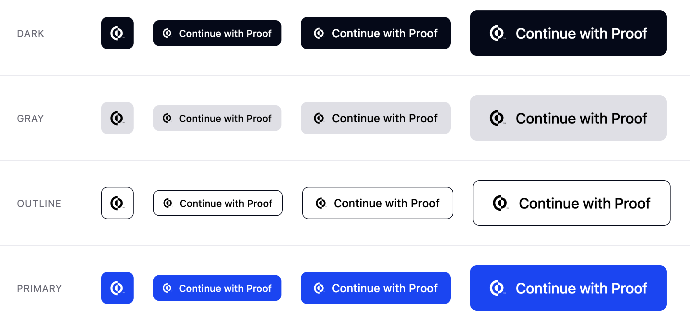

# proof-vc-web

proof-vc-web lets your website ask a user for their Proof Digital ID with one button.

`<proof-verify-id>` is a Web Component. It works in plain HTML, React, Vue, Svelte and other
frameworks. When the user clicks it, the browser goes to Proof, the user presents their Digital ID,
and Proof sends the user back to your website with the presentation (`vp_token`). Your server then
verifies the presentation with [proof-vc-server](https://github.com/proof/proof-vc-common).



To build the authorization request URL yourself, without a button, use
[proof-vc-common](https://github.com/proof/proof-vc-common).

- [Installation](#installation)
- [Quickstart](#quickstart)
- [Usage](#usage)
  - [Receive the presentation on your server](#receive-the-presentation-on-your-server)
  - [Request other claims](#request-other-claims)
  - [Pre-fill the user's email and keep your state](#pre-fill-the-users-email-and-keep-your-state)
  - [Build the authorization URL on your server](#build-the-authorization-url-on-your-server)
  - [Start the flow from your own code](#start-the-flow-from-your-own-code)
  - [Use React](#use-react)
  - [Change the style](#change-the-style)
- [Attributes](#attributes)
- [Properties](#properties)
- [Reference](#reference)
- [Errors](#errors)
- [Links](#links)
- [Contributing](#contributing)
- [License](#license)

## Installation

```sh
npm install @proof.com/proof-vc-web
```

To verify the presentation on your server, also install proof-vc-server there:

```sh
npm install @proof.com/proof-vc-server
```

You need a Proof client ID. [Set up an OAuth application](https://dev.proof.com/docs/oauth-client-credentials)
in your Proof account, and add your callback URL to its redirect URIs.

## Quickstart

This flow has three steps: the button page, the callback page, and the verification on your server.

**1. Show the button.** Import the package once in your page's JavaScript. The import registers
`<proof-verify-id>`.

```js
import "@proof.com/proof-vc-web";
```

Your server makes a new random `nonce` for each page view, keeps it in the user's session, and
writes it in the page:

```html
<proof-verify-id
  environment="sandbox"
  client-id="<CLIENT_ID>"
  callback-uri="https://example.com/callback"
  nonce="3e8e4918-e9fb-453a-a538-81152be15c1b"
></proof-verify-id>
```

On `sandbox`, Proof asks for a phone number: enter any number, then click **Use test code** to skip
the text message.

**2. Read the presentation on the callback page.** Proof sends the user to
`https://example.com/callback#vp_token=...`. Send the `vp_token` to your server:

```js
import { parseAuthorizationResponse } from "@proof.com/proof-vc-web";

const response = parseAuthorizationResponse();
if (response?.type === "success") {
  await fetch("/verify", {
    method: "POST",
    body: new URLSearchParams({ vp_token: response.vpToken }),
  });
} else if (response?.type === "error") {
  console.error(response.error, response.errorDescription);
}
```

**3. Verify the presentation on your server.** Compare the credential's nonce with the nonce in
the user's session:

```js
import { createVerifier, ProofCredentialV1 } from "@proof.com/proof-vc-server";

const verifier = createVerifier({ environment: "sandbox" });

const presentation = await verifier.verifyVPToken({
  encodedVPToken: vpToken,
  aud: "<CLIENT_ID>",
});
const credential = presentation.proof_id_default?.[0];

const nonce = credential?.getNonce();
if (nonce !== undefined && nonce !== session.nonce) {
  throw new Error("nonce mismatch");
}
if (credential instanceof ProofCredentialV1) {
  console.log(credential.toJSON());
  // => { givenName: "Alexander J", familyName: "Sample", isOver18: true, ... }
}
```

## Usage

### Receive the presentation on your server

With `response-mode="direct_post"`, Proof's servers send the `vp_token` to your server in a POST
request, and you do not need a callback page. Set `callback-uri` to your server endpoint. Proof
must be able to reach it: use a public HTTPS URL, not `localhost`.

```html
<proof-verify-id
  environment="sandbox"
  client-id="<CLIENT_ID>"
  callback-uri="https://example.com/verify"
  response-mode="direct_post"
  nonce="3e8e4918-e9fb-453a-a538-81152be15c1b"
></proof-verify-id>
```

Your endpoint receives an `application/x-www-form-urlencoded` body:

```
POST https://example.com/verify

vp_token=eyJwcm9vZl9pZF9...&state=6A2B4CD830
```

Verify `vp_token` as in step 3 of the [Quickstart](#quickstart).

### Request other claims

`scope` sets the claims that the user presents. The default is
`urn:proof:params:scope:verifiable-credentials:basic`.

```html
<proof-verify-id
  environment="sandbox"
  client-id="<CLIENT_ID>"
  callback-uri="https://example.com/callback"
  nonce="3e8e4918-e9fb-453a-a538-81152be15c1b"
  scope="urn:proof:params:scope:verifiable-credentials:nationality:us"
></proof-verify-id>
```

| `scope`                                                        | Claims                                              | Credential id             |
| -------------------------------------------------------------- | --------------------------------------------------- | ------------------------- |
| `urn:proof:params:scope:verifiable-credentials:basic`          | `given_name`, `family_name`, `age_equal_or_over.18` | `proof_id_default`        |
| `urn:proof:params:scope:verifiable-credentials:nationality:us` | `age_equal_or_over.18`, `is_national.us`            | `proof_id_nationality_us` |

### Pre-fill the user's email and keep your state

`login-hint` pre-fills the user's email on Proof. Proof sends `state` back to you with the
presentation; `parseAuthorizationResponse` returns it as `response.state`.

```html
<proof-verify-id
  environment="sandbox"
  client-id="<CLIENT_ID>"
  callback-uri="https://example.com/callback"
  nonce="3e8e4918-e9fb-453a-a538-81152be15c1b"
  login-hint="alexander.sample@example.com"
  state="6A2B4CD830"
></proof-verify-id>
```

### Build the authorization URL on your server

Set the `resolveAuthorizationUrl` property to get the URL from your server, for example to use
[Pushed Authorization Requests or Secured Authorization Requests](https://github.com/proof/proof-vc-common#pushed-authorization-requests)
with proof-vc-server. When you set it, the element ignores its other attributes. Return `null` to
cancel the redirect.

```js
const button = document.querySelector("proof-verify-id");

button.resolveAuthorizationUrl = async () => {
  const response = await fetch("/proof/authorization-url", { method: "POST" });
  if (!response.ok) return null;
  const { url } = await response.json();
  return url;
};
```

Your server creates the URL with proof-vc-server:

```js
import { createClient } from "@proof.com/proof-vc-server";

const proof = createClient({
  environment: "sandbox",
  clientId: "<CLIENT_ID>",
  clientSecret: process.env.PROOF_CLIENT_SECRET,
  callbackUri: "https://example.com/verify",
  responseMode: "direct_post",
  usePushedAuthorizationRequest: true,
});

const url = await proof.authorizationUrl({
  nonce: session.nonce,
  scope: "urn:proof:params:scope:verifiable-credentials:basic",
});
```

### Start the flow from your own code

`click()` on the element starts the flow, for example when the user submits your form:

```js
form.addEventListener("submit", (event) => {
  event.preventDefault();
  form.querySelector("proof-verify-id").click();
});
```

### Use React

`<proof-verify-id>` works in React 19 and later. Import the package once, for example in your
entry file:

```tsx
import "@proof.com/proof-vc-web";

export function VerifyButton({ nonce }: { nonce: string }) {
  return (
    <proof-verify-id
      environment="sandbox"
      client-id="<CLIENT_ID>"
      callback-uri="https://example.com/callback"
      nonce={nonce}
      theme="dark"
    />
  );
}
```

To type-check the element in TSX, add the React types to your `tsconfig.json`:

```json
{
  "compilerOptions": {
    "types": ["@proof.com/proof-vc-web/react"]
  }
}
```

Or add this line to a `.d.ts` file in your project:

```ts
/// <reference types="@proof.com/proof-vc-web/react" />
```

React 19 sets `resolveAuthorizationUrl` as a property. With React 18 or earlier, set it through a
`ref`.

### Change the style

`theme` sets the colors and `size` sets the dimensions:

```html
<proof-verify-id theme="dark" size="large" ...></proof-verify-id>
```



## Attributes

| Attribute       | Required | Default                                               | Description                                                              |
| --------------- | -------- | ----------------------------------------------------- | ------------------------------------------------------------------------ |
| `environment`   | yes      |                                                       | `"sandbox"` or `"production"`                                            |
| `client-id`     | yes      |                                                       | Your Proof client ID                                                     |
| `callback-uri`  | yes      |                                                       | Where Proof sends the presentation; one of your client's redirect URIs   |
| `nonce`         | yes      |                                                       | A new random value for each request; compare it when you verify          |
| `scope`         | no       | `urn:proof:params:scope:verifiable-credentials:basic` | The claims to request; see [Request other claims](#request-other-claims) |
| `response-mode` | no       | `fragment`                                            | `fragment` sends the user to `callback-uri`; `direct_post` posts to it   |
| `state`         | no       |                                                       | A value that Proof sends back with the presentation                      |
| `login-hint`    | no       |                                                       | The user's email, pre-filled on Proof                                    |
| `theme`         | no       | `primary`                                             | `primary`, `dark`, `gray` or `outline`                                   |
| `size`          | no       | `medium`                                              | `small`, `medium`, `large` or `icon` (no label)                          |

## Properties

| Property                  | Description                                                                                    |
| ------------------------- | ---------------------------------------------------------------------------------------------- |
| `nonce`                   | Same as the `nonce` attribute                                                                  |
| `resolveAuthorizationUrl` | `() => string \| null \| Promise<string \| null>`; returns the URL to go to, `null` cancels it |

## Reference

| Name                         | Description                                                                 |
| ---------------------------- | --------------------------------------------------------------------------- |
| `<proof-verify-id>`          | The button; the import registers it                                         |
| `ProofVerifyId`              | The element's class                                                         |
| `parseAuthorizationResponse` | Reads the presentation or the error from the callback URL                   |
| `buildAuthorizationUrl`      | Builds the authorization request URL from the same values as the attributes |
| `Environment`                | Type: `"sandbox" \| "production"`                                           |
| `ResponseMode`               | Type: `"fragment" \| "direct_post"`                                         |
| `Scope`                      | Type of `scope`                                                             |

## Errors

| What you see                                                           | Cause                                                       | What to do                                          |
| ---------------------------------------------------------------------- | ----------------------------------------------------------- | --------------------------------------------------- |
| `<proof-verify-id>: missing required attribute(s): ...` in the console | A required attribute is missing; the button does nothing    | Add the attributes in the message                   |
| `parseAuthorizationResponse()` returns `{ type: "error" }`             | Proof did not give a presentation; read `error`             | Show `errorDescription` and let the user try again  |
| `parseAuthorizationResponse()` returns `null`                          | The callback URL has no `vp_token` and no `error`           | Check that `callback-uri` points to this page       |
| `verifyVPToken` rejects                                                | The presentation is not valid for this environment or `aud` | Use the same `environment` and client ID everywhere |

## Links

- [Read the Proof Digital ID guides](https://dev.proof.com/docs/digital-credentials-overview)
- [Read the API documentation](https://dev.proof.com/reference/authorizeverifiablecredentialpresentation)
- [Request and verify Proof Digital IDs with proof-vc-common and proof-vc-server](https://github.com/proof/proof-vc-common)
- [Try Proof Digital IDs](https://try.proof.com)

## Contributing

[Contribution guidelines for this project](CONTRIBUTING.md)

## License

[Apache-2.0](LICENSE)
